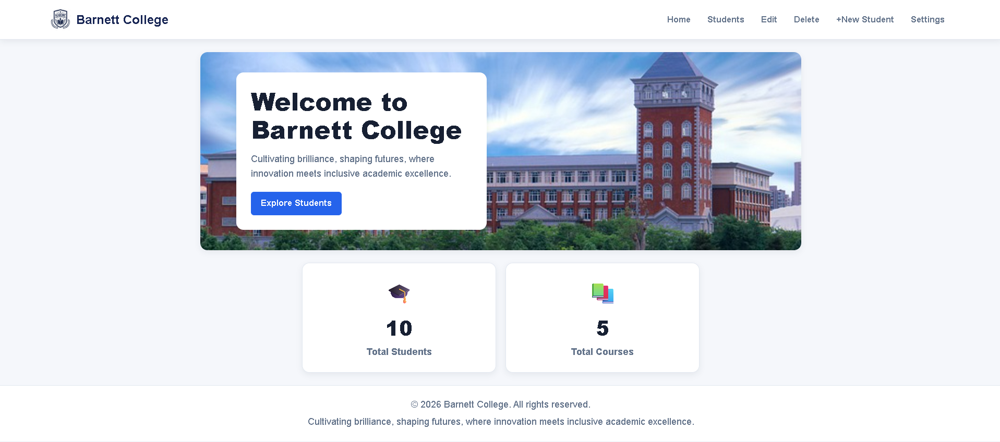
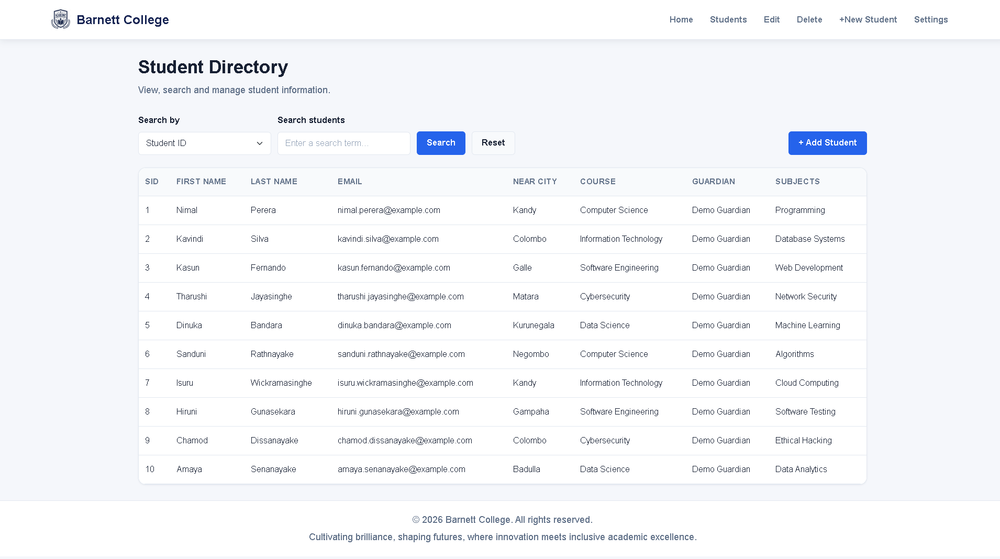
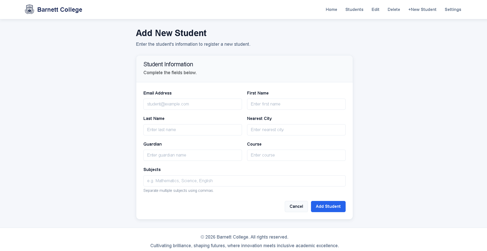
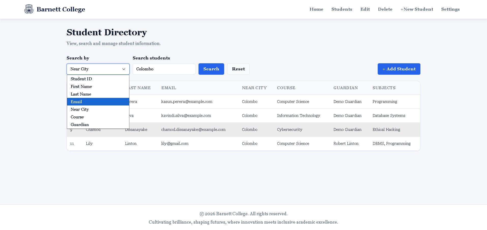
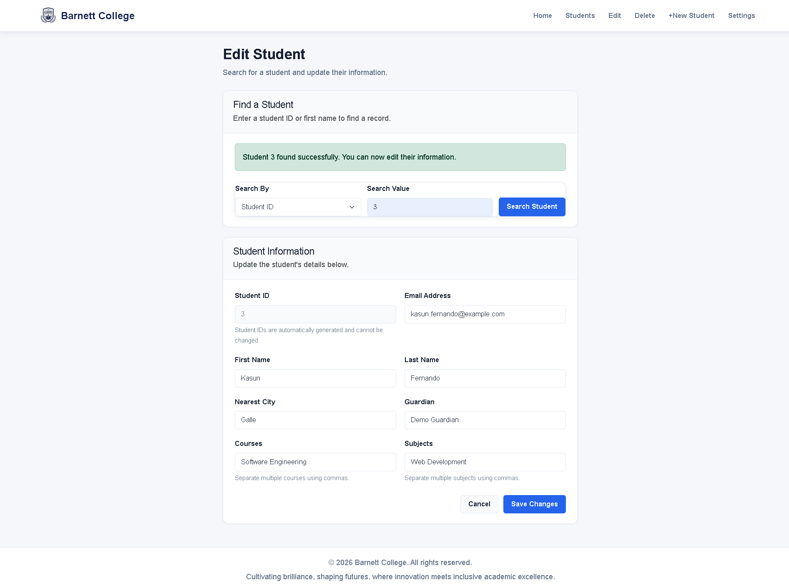
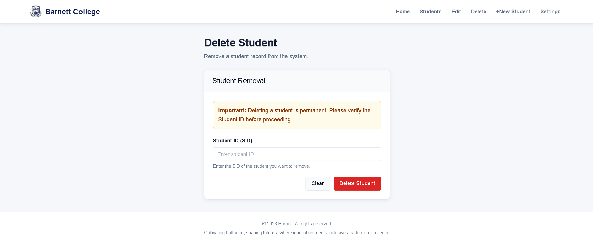
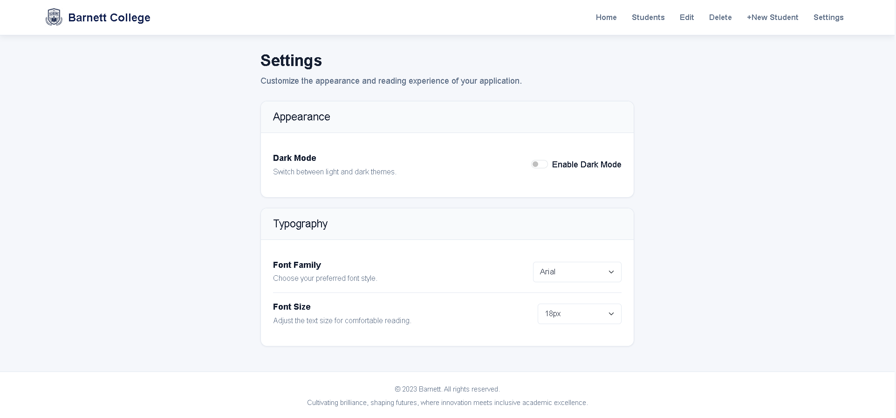
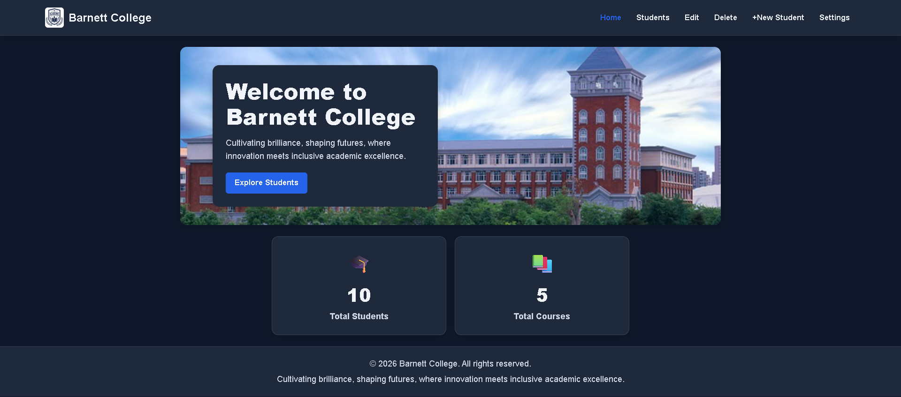

# Student Management System

A web-based student record management application for educational institutions, built with **HTML, CSS, JavaScript, Node.js, Express, and MongoDB**.

The application provides an interface for managing student information alongside a REST API for creating, retrieving, searching, updating, and deleting records.

## Application Preview

### Homepage



### Student Management Screenshots

| Student List | Add Student |
|---|---|
|  |  |

| Search Student | Update Student |
|---|---|
|  |  |

| Delete Student | Settings |
|---|---|
|  |  |

### Dark Mode




## Demo Video

[](https://youtu.be/bqFtOPTGlNE)

Click the image to watch the application demonstration on YouTube.

## Key Features

- **Student records:** Add, view, update, search, and delete students.
- **Automatic student IDs:** Unique numeric SIDs generated by the backend.
- **Flexible search:** Search by SID, first name, last name, email, city, course, or guardian.
- **Input validation:** Required-field checks, email format checks, maximum field lengths, and one-word first/last names.
- **Data integrity:** Rejects attempts to modify an existing SID.
- **Interface options:** Settings and dark-mode screens.
- **API regression testing:** Postman collection automated with Newman.

## Technology Stack

| Component | Technology |
|---|---|
| Frontend | HTML, CSS, JavaScript |
| Backend | Node.js, Express.js |
| Database | MongoDB Atlas |
| Data modeling | Mongoose |
| API testing | Postman, Newman |

## System Architecture

```text
Browser (HTML / CSS / JavaScript)
             |
             | HTTP requests
             v
      Express REST API
             |
             v
           Mongoose
             |
             v
         MongoDB Atlas
```

The Express application serves the frontend from `public/` and exposes endpoints under `/students`. Mongoose handles database interaction and schema validation.

## REST API

| Method | Endpoint | Description |
|---|---|---|
| `GET` | `/students` | Retrieve student records |
| `POST` | `/students` | Create a student with an automatically generated SID |
| `PUT` | `/students/update/:option` | Update a student identified by SID |
| `DELETE` | `/students/:id` | Delete a student by SID |
| `GET` | `/students/search/:option/:value` | Search student records |

Search options: `SID`, `firstname`, `lastname`, `email`, `city`, `course`, and `guardian`.

### Example: Create a Student

```http
POST /students
Content-Type: application/json
```

```json
{
  "firstName": "John",
  "lastName": "Smith",
  "email": "john.smith@example.com",
  "nearCity": "Kandy",
  "course": ["Computer Science"],
  "guardian": "David Smith",
  "subject": ["Programming"]
}
```

On success, the API responds with HTTP `201 Created` and the saved student, including its generated `SID`.

## Run Locally

### Prerequisites

- Node.js and npm
- MongoDB Atlas connection string

### Installation

```bash
git clone https://github.com/JanudiRisaka/Student-management-system.git
cd Student-management-system
npm install
```

Create a `.env` file based on `.env.example`:

```env
MONGODB_URI=your_mongodb_connection_string
PORT=3000
```

Start the server:

```bash
npm run serve
```

Open **http://localhost:3000**.

For development with automatic restarts:

```bash
npm run dev
```

Never commit `.env` files or database credentials.

## API Testing and Quality Assurance

The project includes automated API regression testing using Newman and a dedicated MongoDB test database.

**Latest recorded local Newman execution:**

| Metric | Result |
|---|---:|
| HTTP requests | 121 |
| Passed assertions | 210 |
| Failed assertions | 0 |
| Failed requests | 0 |
| Total execution time | 34.1 s |
| Average response time | 74 ms |

**Status: PASS** — results reported from the local Newman run on 20 November 2026.

The test suite includes validation, error handling, CRUD operations, search behaviour, SID protection, and regression checks for first and last names.

Run automated tests with:

```bash
npm test
```

**Testing safety:** Newman uses a separate test database and may reset its records. Review [the testing setup guide](docs/api-testing/README.md) before running it. Do not use a production database.

## Repository Structure

```text
Student-management-system/
├── public/                  # Frontend application
├── models/                  # Mongoose data models
├── collection/              # Postman collection and environment
├── scripts/                 # Test runner and utility scripts
├── docs/
│   ├── api-testing/         # Test cases and execution reports
│   ├── screenshots/         # Application screenshots
│   └── demo/                # Application walkthrough video
├── server.js                # Express application and REST API
├── package.json
└── README.md
```

## Technical Documentation

- [API Testing Guide](docs/api-testing/README.md)
- [Test Case Catalogue](docs/api-testing/test-cases.md)
- [Test Execution Results](docs/api-testing/test-execution-results.md)

## Implementation Notes

- SIDs are generated by the backend rather than accepted from creation requests.
- Existing student SIDs cannot be updated.
- Student ID parameters must be positive safe integers.
- Automated tests verify defined scenarios; passing results do not guarantee production readiness.